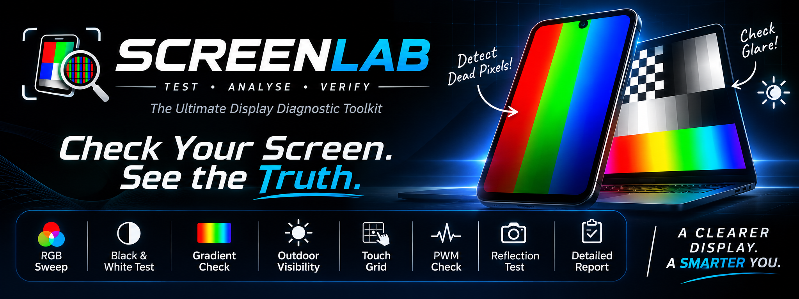
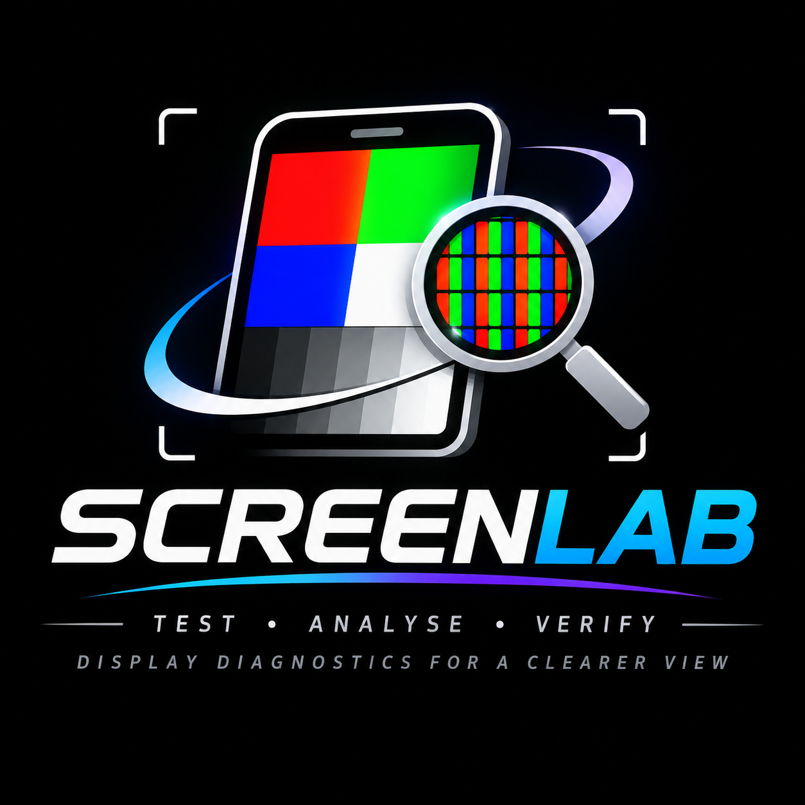

<div align="center">



<br><br>



[](#)
[](#)
[](#)
[](#)
[](#)

[Live Demo](https://justincheriyantiju-glitch.github.io/screenlab/) · [Features](#-features) · [Quick Start](#-quick-start) · [Privacy](#-privacy) · [Limitations](#%EF%B8%8F-limitations)

</div>

---

## 📖 Overview

**SCREENLAB** brings essential panel, subpixel, and touchscreen diagnostics together in a single browser-native interface. Whether you are inspecting a newly unboxed monitor, verifying a smartphone screen replacement, or checking for OLED burn-in and backlight bleed, SCREENLAB runs fullscreen calibrated patterns directly in your browser—with no installation or sign-up required.

---

## ✨ Features

### 🖥️ Panel & Pixel Diagnostics
| Module | Description |
| :--- | :--- |
| **RGB Subpixel Matrix** | Pure red, green, blue, and 1px subpixel stripe patterns to isolate stuck subpixels or colour tinting. |
| **Uniformity & Bleed** | Full-field pure black, pure white, 50% neutral grey, and pixel checkerboards to inspect backlight bleed, IPS glow, and clouding. |
| **Dead & Hot Pixel Sweep** | 8-colour high-contrast solid sweep (`Black`, `White`, `R`, `G`, `B`, `C`, `M`, `Y`) for rapid defect spotting. |
| **Gradient & Banding** | Continuous luminance ramps, colour bars, and full-spectrum hue sweeps to reveal 6-bit/8-bit colour banding. |
| **Grayscale & Contrast** | Near-black shadow separation bars to detect black crush and gamma inaccuracies. |

### ☀️ Visibility & Motion Analysis
| Module | Description |
| :--- | :--- |
| **Outdoor Readability** | Step-down contrast typography checks to evaluate legibility under bright ambient light. |
| **PWM Flicker & Refresh Rate** | High-speed motion pursuit bar, camera shutter banding guide, and live `requestAnimationFrame` refresh rate telemetry. |
| **Reflection & Glare** | Ambient specular reflection rating and optional camera-assisted reflection inspection. |

### 👆 Touchscreen Digitizer
* **Interactive Multi-Touch Grid:** Edge-to-edge touch matrix with multi-finger tracking to detect unresponsive dead zones and verify simultaneous touch points.

### 📊 Local Diagnostic Reporting
* **Session Tracking:** Automatically logs pass/issue statuses across all modules in `localStorage`.
* **Export & Print:** Copy plain-text diagnostic summaries to the clipboard or print/save formatted PDF reports.

---

## 🚀 Quick Start

### Option 1: Run in Browser
Open [SCREENLAB on GitHub Pages](https://justincheriyantiju-glitch.github.io/screenlab/) and click **Run Full Diagnostic Suite** (or launch individual modules).

### Option 2: Run Locally
Because SCREENLAB is built entirely with vanilla web standards, no build tools or package managers are required:

```bash
# Clone the repository
git clone [https://github.com/justincheriyantiju-glitch/screenlab.git](https://github.com/justincheriyantiju-glitch/screenlab.git)

# Navigate into the project directory
cd screenlab

# Open directly in your default browser
open index.html
